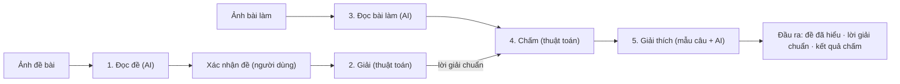

# Đặc tả phạm vi & chức năng — Gia sư Lý thuyết đồ thị

Bản gốc (có thể sửa, comment): https://claude.ai/artifact/8gqTghmgaUBgPNK4GmzB65
Bản xuất ngày 2026-11-14.

## 1. Mục tiêu và định nghĩa thành công

Sản phẩm nhận **ảnh đề bài** và **ảnh bài làm** Lý thuyết đồ thị, trả về **lời giải đúng từng bước** và **kết quả chấm chỉ ra bước sai đầu tiên**. Dự án thành công khi bài toán vào – ra này đạt các chỉ số nghiệm thu ở mục 8 trên bộ test chuẩn.

**Người dùng:** học sinh THPT lớp 11–12 tự học, ôn thi; giáo viên dùng để chấm nhanh và minh họa trên lớp.

**Nguyên tắc cốt lõi:**

- AI chỉ làm hai việc: **đọc ảnh** và **diễn đạt lời giải thích**.
- **Thuật toán quyết định đúng/sai** và mọi con số; không để AI tự kết luận.
- Chấp nhận **mọi cách giải hợp lệ**, không bắt giống đáp án mẫu.
- **Không chắc thì hỏi lại**, không bao giờ kết luận sai một cách âm thầm.

## 2. Phạm vi

Phiên bản 1 phủ 8 dạng bài Lý thuyết đồ thị của chương trình THPT, trên đồ thị vô hướng, trọng số dương, tối đa 20 đỉnh.

### 2.1 Dạng bài trong phạm vi

| # | Dạng bài | Yêu cầu cụ thể | Cách máy kiểm chứng |
| --- | --- | --- | --- |
| 1 | Đỉnh, cạnh | Liệt kê, đếm; nhận biết khuyên, đa đồ thị, đơn đồ thị, đỉnh cô lập; cạnh có tên riêng (a, b, m…) | Đếm trực tiếp trên mô hình |
| 2 | Bậc của đỉnh | Tính bậc, tổng bậc = 2 × số cạnh, số đỉnh bậc lẻ; dãy bậc có tồn tại đồ thị không | Havel–Hakimi (đơn đồ thị), chẵn lẻ (đa đồ thị) |
| 3 | Đường đi, liên thông | Tìm đường đi giữa 2 đỉnh, xét liên thông | BFS/DFS |
| 4 | Euler | Điều kiện tồn tại; tìm đường đi hoặc chu trình; bài "vẽ một nét" | Bậc + liên thông, Hierholzer |
| 5 | Hamilton | Dirac, Ore, quy tắc đỉnh bậc 1 và bậc 2; tìm hoặc chứng minh không có | Quay lui / quy hoạch động bitmask (vét cạn) |
| 6 | Đường đi ngắn nhất | Dijkstra: gán nhãn, khoanh tròn, cập nhật nhãn, truy vết | Dijkstra có ghi trace, chấp nhận đồng hạng |
| 7 | Người du lịch (TSP) | Láng giềng gần nhất từ một hoặc mọi đỉnh; chu trình tối ưu thật | Mô phỏng láng giềng + vét cạn |
| 8 | Người đưa thư | Mọi đỉnh bậc chẵn; đúng 2 đỉnh bậc lẻ; nhiều hơn 2 đỉnh bậc lẻ | Euler + đường ngắn nhất + ghép cặp nhỏ nhất (vét cạn) |

### 2.2 Dạng đề và dạng câu hỏi

- **Cách cho đồ thị:** hình vẽ (in hoặc vẽ tay), bảng / ma trận kề / bảng khoảng cách, lời văn mô tả quan hệ.
- **Dạng câu hỏi:** tự luận, trắc nghiệm 4 lựa chọn, đúng/sai 4 ý, trả lời ngắn.
- **Bài thực tế có phép tính kèm:** ví dụ đổi quãng đường ra thời gian, cộng thời gian dừng, làm tròn.

### 2.3 Ngoài phạm vi phiên bản 1

- Đồ thị có hướng; trọng số âm (chỉ cảnh báo "Dijkstra không áp dụng").
- Đồ thị trên 20 đỉnh.
- Chủ đề khác: cây khung, tô màu, luồng, ghép cặp tổng quát.
- Chấm bài chứng minh lý thuyết tổng quát (chỉ trả lời kèm nhãn "chưa kiểm chứng").
- Quản lý lớp học, giao bài, sổ điểm.
- Đọc ảnh khi không có mạng.

## 3. Đầu vào – đầu ra

Một lượt xử lý nhận ảnh đề (bắt buộc) và ảnh bài làm (tùy chọn), trả về 3 phần: đề đã hiểu, lời giải chuẩn, kết quả chấm.

### 3.1 Đầu vào

| Đầu vào | Bắt buộc | Quy cách |
| --- | --- | --- |
| Ảnh đề bài | Có | Chụp hoặc tải lên; JPG/PNG/HEIC; tối đa 10 MB; một đề có thể gồm nhiều ảnh |
| Ảnh bài làm | Không | Viết tay hoặc in; có thể nhiều trang; trình bày bằng lời văn hoặc kẻ bảng |
| Nhập tay (thay thế) | Không | Vẽ đồ thị trực tiếp, gõ đề, gõ hoặc chọn các bước giải |

### 3.2 Đầu ra

1. **Đề đã hiểu:** đồ thị (đỉnh, cạnh, trọng số) vẽ lại cạnh ảnh gốc, yêu cầu đề, dạng câu hỏi. Chỗ đọc chưa chắc được tô nổi để người dùng xác nhận hoặc sửa.
2. **Lời giải chuẩn:** đáp án, các bước giải theo cách trình bày của SGK, hình tô màu đường đi, mô phỏng từng bước.
3. **Kết quả chấm** (khi có bài làm), một trong bốn trạng thái:

| Trạng thái | Khi nào | Nội dung trả về |
| --- | --- | --- |
| ĐÚNG | Mọi bước hợp lệ và đáp án đúng | Giải thích ngắn, lưu ý và bẫy thường gặp của dạng bài |
| SAI | Có bước không hợp lệ hoặc đáp án sai | Bước sai đầu tiên, vị trí trên ảnh, loại lỗi, nguyên nhân, cách sửa |
| CẦN XÁC NHẬN | Bước nghi sai trùng chỗ máy đọc chưa chắc | Hỏi lại đúng chỗ đó, chấm lại sau khi người dùng xác nhận |
| KHÔNG ĐỦ CĂN CỨ | Ảnh mờ, thiếu trang, chỉ có đáp số không có bước | Nêu rõ còn thiếu gì, đề nghị chụp lại hoặc nhập tay |

## 4. Pipeline xử lý

Năm khâu nối tiếp, mỗi khâu trả về JSON kiểm tra được; AI chỉ nằm ở khâu đọc ảnh và khâu diễn đạt.



Nhánh trên xử lý đề, nhánh dưới xử lý bài làm; hai nhánh gặp nhau ở khâu chấm, nơi lời giải chuẩn làm căn cứ.

### 4.1 Dữ liệu trung gian

**Đề đã hiểu (khâu 1 → 2):**

```json
{
  "graph": { "directed": false,
    "vertices": ["A","B","C","D","E"],
    "edges": [{"id":"e1","u":"A","v":"B","w":3}, {"id":"e2","u":"A","v":"C","w":1}] },
  "task": { "type": "shortest_path", "from": "A", "to": "E" },
  "questionFormat": "tu_luan",
  "uncertain": [{ "item": "e4.w", "candidates": [7, 1] }]
}
```

**Bài làm đã đọc (khâu 3 → 4):** chuỗi mệnh đề theo thứ tự học sinh viết, mỗi mệnh đề giữ câu gốc và vị trí trên ảnh.

```json
[
  {"step":1, "raw":"Gán nhãn A = 0", "claim":{"type":"label","v":"A","value":0}, "box":[40,120,210,150], "conf":0.97},
  {"step":2, "raw":"Khoanh tròn C", "claim":{"type":"select","v":"C"}, "box":[40,160,190,190], "conf":0.95},
  {"step":3, "raw":"Tại B đổi nhãn 3 thành 2", "claim":{"type":"label","v":"B","value":2,"via":"C"}, "box":[40,200,320,230], "conf":0.91}
]
```

**Kết quả chấm (khâu 4 → 5):**

```json
{ "verdict": "SAI", "firstErrorStep": 3, "errorCode": "SAI_PHEP_TINH",
  "facts": { "edge": "C-B", "nC": 1, "w": 3, "expected": 4, "got": 2 } }
```

Các loại mệnh đề cần hỗ trợ (khoảng 15–20): bậc, số đỉnh bậc lẻ, liên thông, tồn tại hoặc không tồn tại đường/chu trình Euler, Hamilton, áp dụng định lý (Dirac, Ore, quy tắc bậc 2), đường đi, độ dài, nhãn, khoanh tròn, lựa chọn láng giềng gần nhất, thêm cạnh lặp (người đưa thư), đáp án cuối.

## 5. Chức năng và mức ưu tiên

MVP (P0) là đủ để chạy trọn bài toán vào – ra; P1 và P2 làm sau khi P0 đạt nghiệm thu.

| Module | Chức năng | Ưu tiên |
| --- | --- | --- |
| Đọc đề | Ảnh đề → đồ thị + yêu cầu; tự kiểm tra chéo; đánh dấu chỗ chưa chắc | P0 – MVP |
| Xác nhận đề | Hiện đồ thị đã đọc cạnh ảnh gốc; sửa đỉnh, cạnh, trọng số, yêu cầu | P0 – MVP |
| Bộ giải | Giải 8 dạng bài, sinh lời giải từng bước theo văn phong SGK | P0 – MVP |
| Kiểm tra mệnh đề | Xét đúng/sai từng phát biểu (câu đúng/sai, trắc nghiệm) | P0 – MVP |
| Đọc bài làm | Ảnh bài làm → chuỗi mệnh đề có thứ tự, giữ vị trí trên ảnh | P0 – MVP |
| Chấm bài | Bước sai đầu tiên, loại lỗi, nguyên nhân, cách sửa; chấp nhận mọi cách giải hợp lệ | P0 – MVP |
| Hiển thị kết quả | Vẽ đồ thị, tô đường đi đúng, đánh dấu bước sai trên hình và trên ảnh | P0 – MVP |
| Mô phỏng thuật toán | Phát lại từng bước (tới, lui, tự chạy), đặt cạnh bài học sinh | P1 |
| Học tương tác | Tự vẽ đồ thị; tự chọn đường đi, gắn nhãn, khoanh tròn; kiểm tra ngay từng thao tác | P1 |
| Gợi ý theo bậc | 4 bậc: câu hỏi định hướng → chỗ cần xem lại → gợi ý cụ thể → lời giải đầy đủ | P1 |
| What-if | Đổi cạnh hoặc trọng số, kết quả cập nhật ngay | P1 |
| Tạo phản ví dụ | Sinh đồ thị nhỏ bác bỏ một nhận định sai | P2 |
| Luyện tập cá nhân hóa | Lưu lỗi hay mắc, sinh bài đúng vào lỗi đó | P2 |
| Hội thoại gia sư | Hỏi đáp tự do về bài đang làm, dựa trên kết quả của bộ giải | P2 |

## 6. Quy tắc chấm bài và phân loại lỗi

Bài làm được chuyển thành chuỗi mệnh đề theo đúng thứ tự học sinh viết; mệnh đề đầu tiên không qua được kiểm tra chính là bước sai đầu tiên.

### 6.1 Quy tắc

1. **Duyệt theo học sinh:** mô phỏng lại thuật toán theo đúng lựa chọn của học sinh. Mỗi bước chỉ hỏi "với trạng thái hiện tại, bước này có hợp lệ không?", không so với một đáp án mẫu duy nhất.
2. **Nhiều lời giải đúng:** đồng hạng trong Dijkstra hoặc láng giềng gần nhất, đường Euler/Hamilton khác đều được chấp nhận.
3. **Chỉ báo bước sai đầu tiên:** sau bước sai, máy tiếp tục bằng trạng thái đúng để có thể ghi chú thêm, nhưng kết luận chính chỉ nêu bước đầu tiên.
4. **Đáp số đúng, lập luận sai vẫn là SAI:** ví dụ kết luận đúng nhưng dùng Dirac khi đồ thị không thỏa điều kiện.
5. **Chỉ có đáp số:** chấm đáp số, ghi rõ "không có bước giải để kiểm tra".
6. **Không chắc thì hỏi:** bước nghi sai mà nằm đúng chỗ máy đọc chưa chắc → trạng thái CẦN XÁC NHẬN, không báo SAI.

### 6.2 Loại lỗi

| Mã lỗi | Ý nghĩa | Ví dụ |
| --- | --- | --- |
| SAI_PHEP_TINH | Tính sai tổng, bậc, độ dài | n(C) + w(CB) = 1 + 3 nhưng ghi 2 |
| SAI_DIEU_KIEN | Áp dụng định lý khi không thỏa giả thiết, hoặc dùng điều kiện đủ như điều kiện cần | "Không thỏa Dirac nên không có chu trình Hamilton" |
| BO_SOT | Bỏ sót cạnh hoặc đỉnh | Không cập nhật nhãn qua cạnh B–D; đường Euler thiếu một cạnh |
| CANH_KHONG_TON_TAI | Đi qua cạnh không có trong đồ thị | Đường đi có bước A→E nhưng A, E không kề |
| LAP | Lặp cạnh (Euler) hoặc lặp đỉnh (Hamilton) | Đi cạnh BC hai lần |
| NHAM_THUAT_TOAN | Làm theo thuật toán khác | Chọn cạnh nhỏ nhất (kiểu Prim) thay vì nhãn nhỏ nhất |
| SAI_LUA_CHON | Chọn sai đỉnh ở một bước của thuật toán | Khoanh đỉnh có nhãn 5 khi còn đỉnh nhãn 4 |
| KET_LUAN_KHONG_SUY_RA | Kết luận không đi ra từ các bước trước | Truy vết sai đường đi dù nhãn đúng |
| HIEU_SAI_DE | Giải sai yêu cầu | Tìm đường đi Euler khi đề hỏi chu trình; TSP không quay về điểm đầu |

### 6.3 Giải thích

Mỗi mã lỗi có một mẫu câu tiếng Việt gồm nguyên nhân, cách sửa và con số lấy từ chính bài. AI chỉ được viết lại cho tự nhiên hơn, không được thêm con số ngoài dữ liệu chấm. Khi bài đúng, kèm danh sách bẫy của dạng bài (ví dụ: láng giềng gần nhất không bảo đảm tối ưu; người đưa thư phải xuất phát đúng đỉnh đề cho).

## 7. Kiến trúc và công nghệ

Web trước (PWA, chạy tốt trên điện thoại), lõi thuật toán viết bằng TypeScript thuần để sau này dùng lại nguyên vẹn cho app React Native.

| Thành phần | Công nghệ đề xuất | Chạy ở đâu | Cần mạng |
| --- | --- | --- | --- |
| Giao diện | React + TypeScript, PWA | Trình duyệt | Không (sau lần tải đầu) |
| Vẽ đồ thị, mô phỏng | SVG tự vẽ hoặc Cytoscape.js | Trình duyệt | Không |
| Lõi giải + chấm | Package TypeScript riêng, không phụ thuộc giao diện, có unit test | Trình duyệt | Không |
| Đọc ảnh đề + bài làm | Vision LLM trên cloud, ép trả JSON theo schema | Máy chủ | Có |
| API trung gian | Node.js hoặc Python (FastAPI): giữ khóa API, giới hạn lượt, ghi log | Máy chủ | Có |
| Lưu trữ | IndexedDB trên máy; tài khoản và đồng bộ để sau | Trình duyệt | Không |
| App di động (sau) | Expo / React Native dùng lại lõi TS | Điện thoại | Chỉ khi đọc ảnh |

**Hệ quả:** khi không có mạng vẫn giải, chấm (với đề và bài nhập tay), mô phỏng và học tương tác được; chỉ bước đọc ảnh cần mạng. Đọc ảnh offline bằng model chạy trên máy là hướng nghiên cứu sau phiên bản 1.

## 8. Kiểm thử và tiêu chí nghiệm thu

Phiên bản 1 được nghiệm thu khi đạt cả 4 chỉ số dưới đây trên bộ test chuẩn.

### 8.1 Bộ test chuẩn

- **Tối thiểu 100 cặp (ảnh đề, ảnh bài làm)**, mỗi cặp kèm đồ thị chuẩn, đáp án chuẩn và bước sai đầu tiên chuẩn (nếu có).
- Phủ đủ 8 dạng bài và 4 dạng câu hỏi; ảnh in và ảnh vẽ tay; nhiều nét chữ khác nhau.
- Tỉ lệ bài: khoảng 40% đúng, 60% sai có chủ đích (mỗi mã lỗi ít nhất 5 bài).
- Ca khó bắt buộc: nhiều đáp án đúng, đồng hạng, không có lời giải, đa đồ thị có khuyên, ảnh mờ hoặc nghiêng, chỉ có đáp số.
- Riêng lõi giải: thêm hàng nghìn đồ thị sinh ngẫu nhiên, so kết quả với vét cạn.

### 8.2 Chỉ số nghiệm thu

| Chỉ số | Cách đo | Mục tiêu |
| --- | --- | --- |
| Đọc đề đúng hoàn toàn | Đủ mọi đỉnh, cạnh, trọng số và yêu cầu, so với đồ thị chuẩn | ≥ 90%; phần còn lại 100% phải bị gắn cờ "chưa chắc" |
| Giải đúng khi đề đúng | Đáp án so với đáp án chuẩn và vét cạn | 100% |
| Kết luận đúng/sai | Trạng thái chấm so với nhãn chuẩn | ≥ 95% |
| Chỉ đúng bước sai đầu tiên | Trên các bài sai, bước và mã lỗi so với nhãn chuẩn | ≥ 90% |

Thời gian phản hồi mục tiêu: dưới 15 giây từ lúc tải ảnh đến khi có kết quả; giải và chấm trên dữ liệu đã xác nhận dưới 1 giây.

## 9. Lộ trình triển khai

Làm phần chắc chắn trước (giải, chấm), đo rủi ro sớm (đọc ảnh), rồi mới ghép giao diện.

1. **Lõi giải + chấm trên JSON nhập tay.** Xong khi: 8 dạng bài giải đúng 100% trên bộ test lõi; chấm đúng bước sai trên các bài sai nhập tay.
2. **Thử đọc ảnh đề** trên khoảng 30 ảnh. Xong khi: có số đo độ chính xác thật và danh sách lỗi đọc hay gặp.
3. **Thử đọc ảnh bài làm** thành chuỗi mệnh đề. Xong khi: có số đo độ chính xác trên khoảng 30 bài viết tay.
4. **Ghép MVP web:** tải ảnh → xác nhận đề → lời giải → kết quả chấm có đánh dấu trên hình. Xong khi: đạt 4 chỉ số ở mục 8.
5. **P1:** mô phỏng, học tương tác, gợi ý theo bậc, What-if.
6. **P2:** phản ví dụ, luyện tập cá nhân hóa, hội thoại gia sư, app di động.

## 10. Các điểm cần chốt

Bản đặc tả đang dựa trên các giả định dưới đây; tích vào ô khi đồng ý, hoặc ghi chú nếu muốn đổi.

- [ ] Đọc ảnh dùng AI trên cloud (cần mạng); phần còn lại chạy được offline.
- [ ] Làm web (PWA) trước, app React Native sau.
- [ ] Phạm vi 8 dạng bài, đồ thị vô hướng, tối đa 20 đỉnh; đồ thị có hướng để sau.
- [ ] Bài đúng đáp số nhưng sai lập luận bị chấm SAI.
- [ ] Các chỉ số nghiệm thu ở mục 8 (90% / 100% / 95% / 90%).
- [ ] Ai chuẩn bị và gán nhãn bộ test 100 cặp ảnh (đề xuất: giáo viên bộ môn).
